# A, run `full1`

Started 2026-11-26T11:58:06, data `bench_data/A` (synthetic). Collected 2026-11-26T13:20:55. Only files written after the start are included.

> **Warning:** fatnarwhal_quant not importable: hedging columns will be empty (pip install -e <fatnarwhal-quant>)

## Models

| model | status | min | label | params | train s | gen s | log | last error |
|---|---|---|---|---|---|---|---|---|
| bsm | ok | 0.1 | baseline_bsm | 0 | 0 | 0.1 | [log](logs/bsm.log) |  |
| bootstrap | ok | 0.1 | baseline_bootstrap | 0 | 0 | 0.1 | [log](logs/bootstrap.log) |  |
| garch | ok | 0.1 | baseline_garch | 4 | 0 | 1.7 | [log](logs/garch.log) |  |
| ar_diffusion | ok | 6.8 | ar_diffusion | 2,088,321 | 274 | 43.2 | [log](logs/ar_diffusion.log) |  |
| ar_token | ok | 2.4 | ar_token256q_mean | 837,504 | 98 | 24.0 | [log](logs/ar_token.log) |  |
| rnade | ok | 53.6 | a3_rnade | 87,340 | 3,038 | 3.1 | [log](logs/rnade.log) |  |
| gan | ok | 7.1 | a4_gan | 293,908 | 274 | 1.7 | [log](logs/gan.log) |  |
| sde_gan | ok | 8.4 | a5_sde_gan | 194,657 | 466 | 12.2 | [log](logs/sde_gan.log) |  |
| pure_diffusion | ok | 1.4 | a6_pure_diffusion | 3,916,052 | 61 | 7.0 | [log](logs/pure_diffusion.log) |  |
| path_flow | ok | 1.2 | a7_path_flow_gauss | 938,944 | 55 | 1.8 | [log](logs/path_flow.log) |  |
| path_flow_t | ok | 1.2 | a7_path_flow_t | 938,944 | 54 | 2.6 | [log](logs/path_flow_t.log) |  |

## Leaderboard

| model | iv_err_atm | iv_err_wings | iv_err_wings_stressed | hedge_std_ratio_wings | hedge_abs_mean_minus_oracle_bps_wings | asian_rel_err | acf_abs_lag1_model | explosive_rate | gen_seconds |
|---|---|---|---|---|---|---|---|---|---|
| ar_diffusion | 0.55 | 1.14 | 1.59 |  |  | 0.0274 | 0.113 | 3.81e-07 | 43.2 |
| baseline_garch | 0.618 | 1.45 | 1.94 |  |  | 0.0252 | 0.151 | 4.58e-06 | 1.72 |
| a7_path_flow_t | 1.03 | 1.52 | 2.23 |  |  | 0.0598 | 0.114 | 6.1e-06 | 2.56 |
| ar_token256q_mean | 1.06 | 1.64 | 2.94 |  |  | 0.0319 | 0.117 | 0 | 24 |
| a5_sde_gan | 1.93 | 2.07 | 3.51 |  |  | 0.116 | 0.157 | 0 | 12.2 |
| a3_rnade | 2.02 | 2.6 | 4.66 |  |  | 0.0777 | 0.0836 | 0 | 3.05 |
| a4_gan | 2.19 | 2.76 | 4.37 |  |  | 0.129 | 0.0651 | 7.63e-06 | 1.69 |
| baseline_bsm | 3.08 | 5.74 | 6.95 |  |  | 0.153 | -8.2e-05 | 0 | 0.0922 |
| baseline_bootstrap | 5.89 | 8.09 | 11.9 |  |  | 0.505 | -0.000551 | 0 | 0.078 |
| a6_pure_diffusion | 9.45 | 8.74 | 23 |  |  | 0.278 | 0.0531 | 0.000221 | 7.03 |
| a7_path_flow_gauss | 39.6 | 32.9 | 88.3 |  |  | inf | 0.139 | 0.000176 | 1.84 |

## Comparison

**smiles**

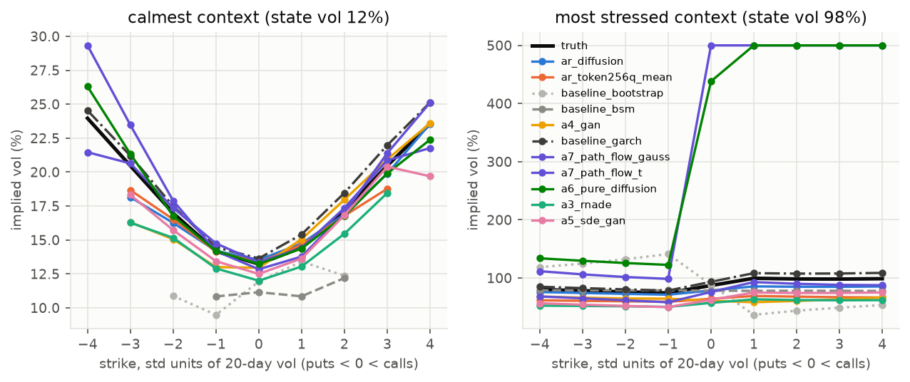

**terminal_distributions**

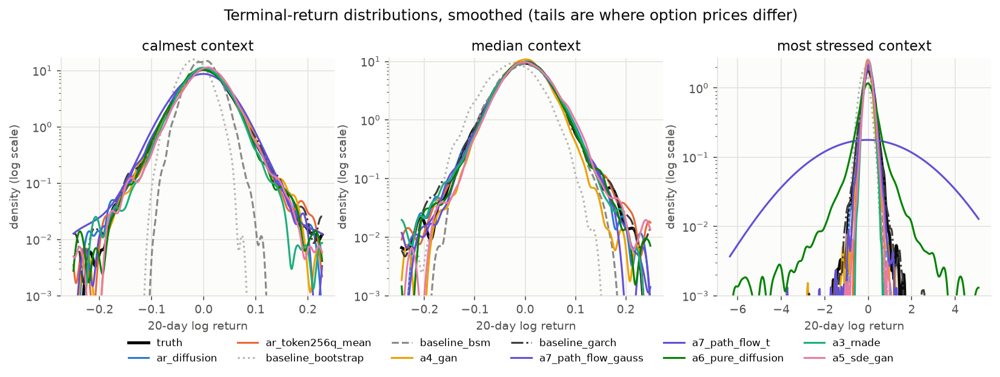

**trackA_leaderboard**

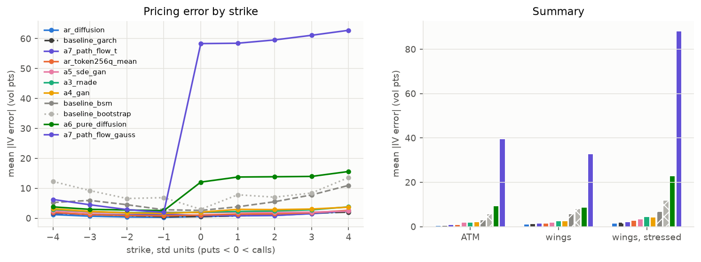

## Training curves

**loss_all**

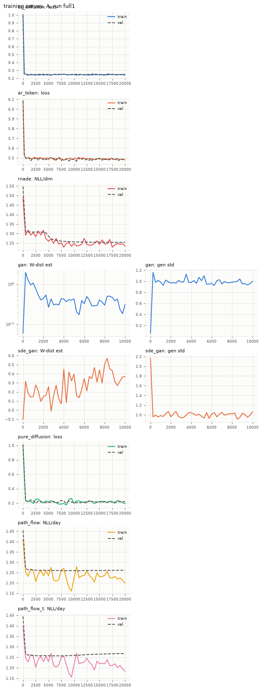

**loss_ar_diffusion**

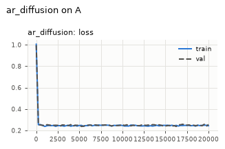

**loss_ar_token**

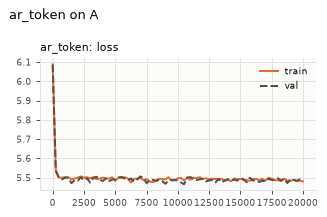

**loss_gan**

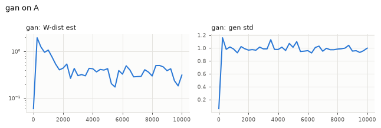

**loss_path_flow**

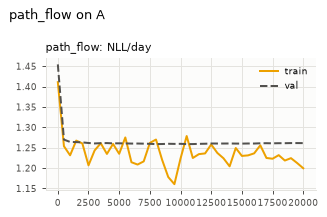

**loss_path_flow_t**

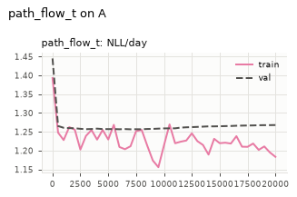

**loss_pure_diffusion**

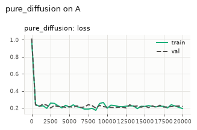

**loss_rnade**

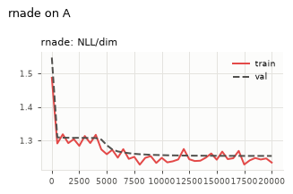

**loss_sde_gan**

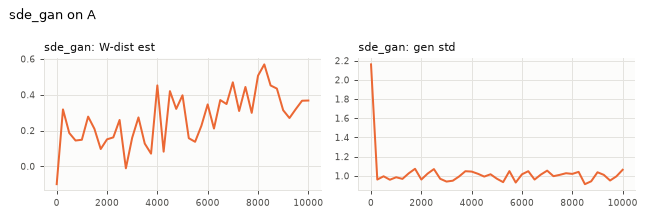

## Simulated paths

**paths_a3_rnade**

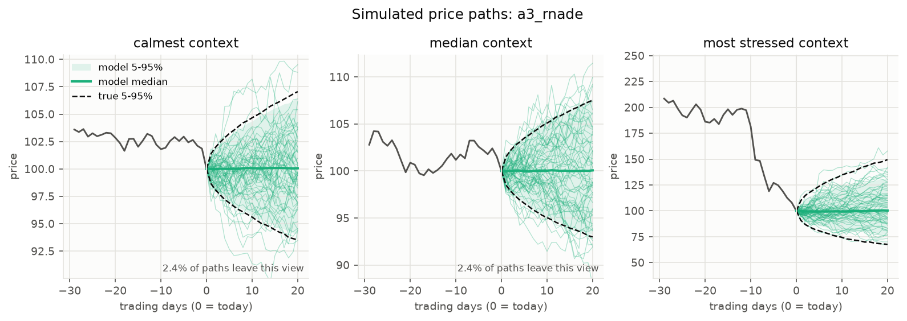

**paths_a4_gan**

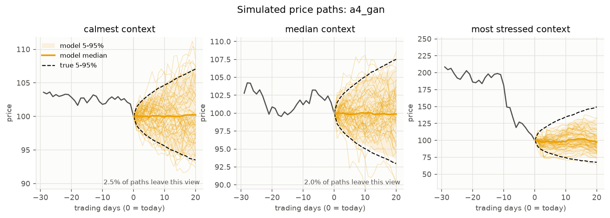

**paths_a5_sde_gan**

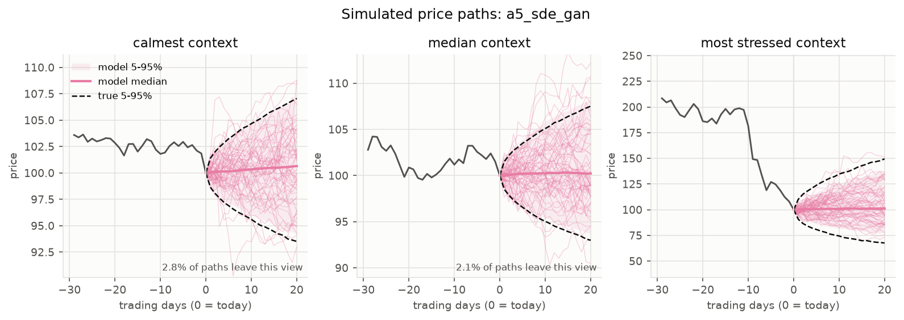

**paths_a6_pure_diffusion**

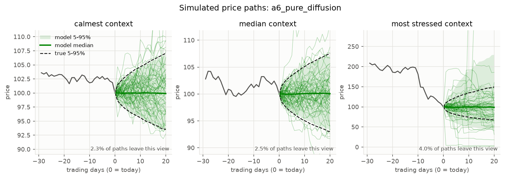

**paths_a7_path_flow_gauss**

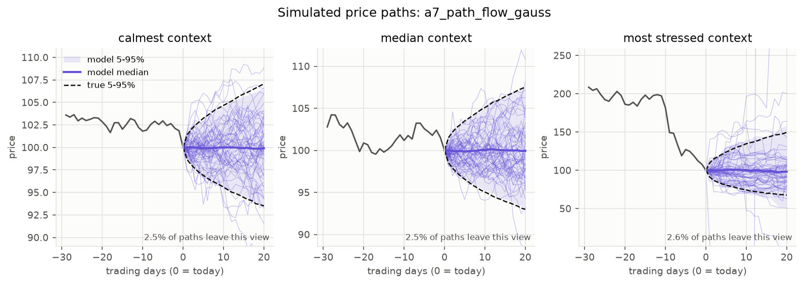

**paths_a7_path_flow_t**

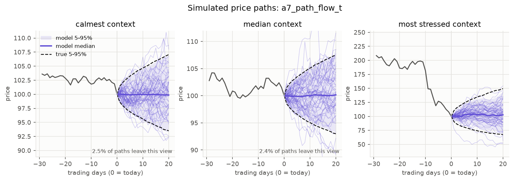

**paths_ar_diffusion**

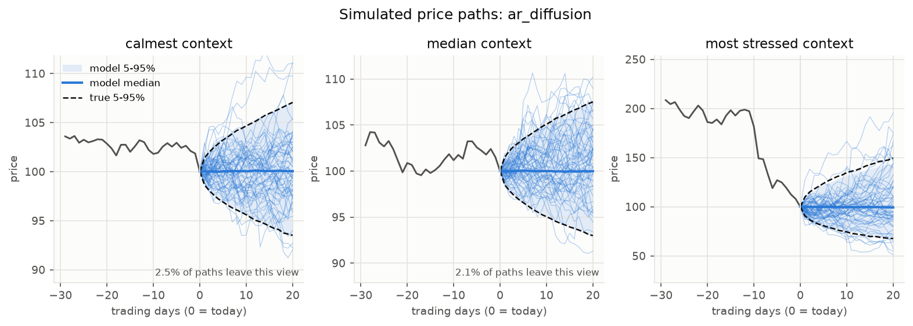

**paths_ar_token256q_mean**

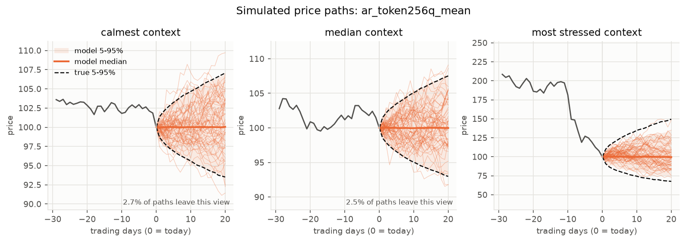

**paths_baseline_bootstrap**

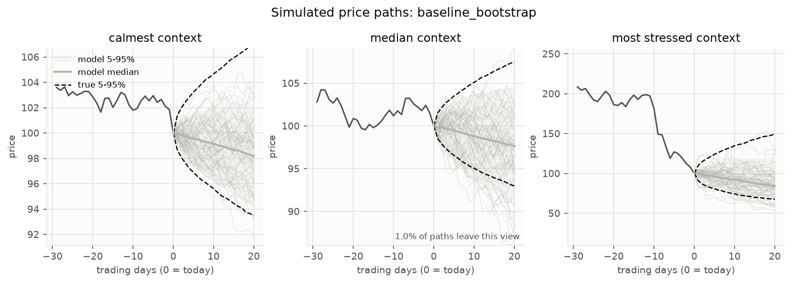

**paths_baseline_bsm**

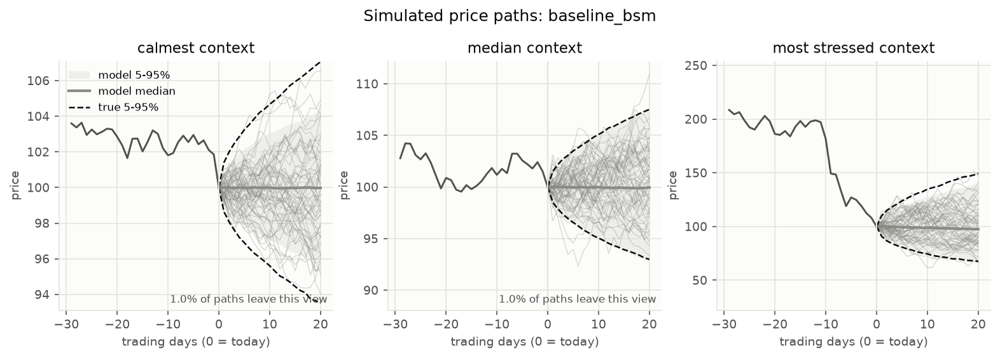

**paths_baseline_garch**

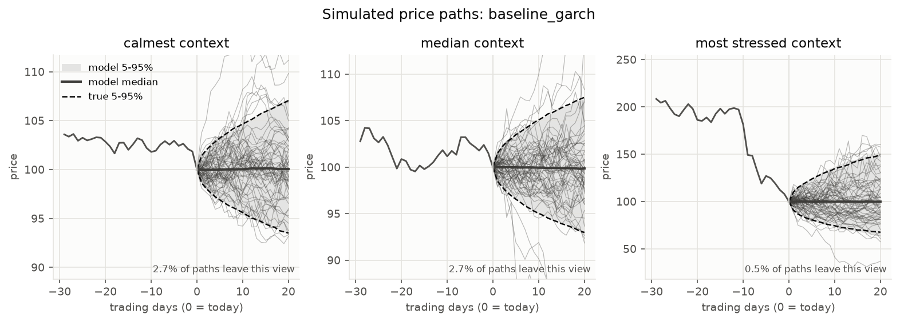

