# A128, run `full2`

Started 2026-11-26T15:11:52, data `bench_data/A128` (synthetic). Collected 2026-11-26T16:49:34. Only files written after the start are included.

> **Warning:** fatnarwhal_quant not importable: hedging columns will be empty (pip install -e <fatnarwhal-quant>)

## Models

| model | status | min | label | params | train s | gen s | log | last error |
|---|---|---|---|---|---|---|---|---|
| bsm | ok | 0.6 | baseline_bsm | 0 | 0 | 0.7 | [log](logs/bsm.log) |  |
| bootstrap | ok | 0.1 | baseline_bootstrap | 0 | 0 | 0.6 | [log](logs/bootstrap.log) |  |
| garch | ok | 0.1 | baseline_garch | 4 | 0 | 3.9 | [log](logs/garch.log) |  |
| ar_diffusion | ok | 12.7 | ar_diffusion | 2,088,321 | 275 | 313.6 | [log](logs/ar_diffusion.log) |  |
| ar_token | ok | 4.9 | ar_token256q_mean | 837,504 | 97 | 170.4 | [log](logs/ar_token.log) |  |
| rnade | ok | 28.4 | a3_rnade | 87,340 | 1,511 | 3.0 | [log](logs/rnade.log) |  |
| gan | ok | 7.0 | a4_gan | 293,908 | 276 | 1.9 | [log](logs/gan.log) |  |
| sde_gan | ok | 8.5 | a5_sde_gan | 194,657 | 467 | 13.4 | [log](logs/sde_gan.log) |  |
| pure_diffusion | ok | 1.9 | a6_pure_diffusion | 3,916,052 | 61 | 36.3 | [log](logs/pure_diffusion.log) |  |
| path_flow_t | ok | 1.2 | a7_path_flow_t | 938,944 | 55 | 2.9 | [log](logs/path_flow_t.log) |  |
| ar_diffusion_s1 | ok | 10.5 | ar_diffusion_s1 | 2,088,321 | 274 | 313.6 | [log](logs/ar_diffusion_s1.log) |  |
| ar_diffusion_s2 | ok | 10.6 | ar_diffusion_s2 | 2,088,321 | 277 | 317.0 | [log](logs/ar_diffusion_s2.log) |  |
| ar_token_s1 | ok | 5.5 | ar_token256q_mean_s1 | 837,504 | 97 | 170.7 | [log](logs/ar_token_s1.log) |  |
| ar_token_s2 | ok | 4.9 | ar_token256q_mean_s2 | 837,504 | 98 | 171.5 | [log](logs/ar_token_s2.log) |  |

## Leaderboard

(common cells: 716 of 768 wing cells, 12 models with <= 25% empty wing cells)

| model | iv_err_atm | iv_err_wings | iv_err_wings_stressed | iv_nan_frac_wings | iv_err_wings_common | iv_err_wings_stressed_common | hedge_std_ratio_wings | hedge_abs_mean_minus_oracle_bps_wings | asian_rel_err | acf_abs_lag1_model | explosive_rate | gen_seconds |
|---|---|---|---|---|---|---|---|---|---|---|---|---|
| ar_diffusion | 0.33 | 0.819 | 0.932 | 0.00651 | 0.783 | 0.934 |  |  | 0.0239 | 0.112 | 2.38e-07 | 314 |
| ar_diffusion_s1 | 0.333 | 0.902 | 1.01 | 0.00651 | 0.862 | 1.01 |  |  | 0.0173 | 0.111 | 2.15e-07 | 314 |
| ar_diffusion_s2 | 0.308 | 0.921 | 1.01 | 0.00781 | 0.887 | 1.01 |  |  | 0.0173 | 0.11 | 2.86e-07 | 317 |
| ar_token256q_mean | 0.512 | 0.959 | 1.39 | 0.0013 | 0.923 | 1.4 |  |  | 0.0212 | 0.118 | 0 | 170 |
| ar_token256q_mean_s2 | 0.436 | 0.993 | 1.53 | 0.00391 | 0.954 | 1.53 |  |  | 0.0175 | 0.118 | 0 | 171 |
| ar_token256q_mean_s1 | 0.499 | 1.2 | 1.78 | 0.00651 | 1.16 | 1.78 |  |  | 0.0202 | 0.112 | 0 | 171 |
| baseline_garch | 0.526 | 1.44 | 1.79 | 0 | 1.41 | 1.8 |  |  | 0.0217 | 0.151 | 9.54e-07 | 3.88 |
| a3_rnade | 1.46 | 1.78 | 2.75 | 0.0143 | 1.8 | 2.76 |  |  | 0.0738 | 0.0838 | 0 | 2.96 |
| a5_sde_gan | 1.93 | 1.92 | 2.77 | 0.00651 | 1.92 | 2.77 |  |  | 0.128 | 0.149 | 0 | 13.4 |
| a4_gan | 2.02 | 2.58 | 4.47 | 0.0299 | 2.61 | 4.47 |  |  | 0.15 | 0.0676 | 4.48e-06 | 1.88 |
| a7_path_flow_t | 3.35 | 3.14 | 1.9 | 0.0026 | 3.26 | 1.91 |  |  | 0.14 | 0.118 | 2.88e-06 | 2.91 |
| a6_pure_diffusion | 3.77 | 3.82 | 9.15 | 0.00781 | 3.95 | 9.2 |  |  | 0.155 | 0.0541 | 6.59e-05 | 36.3 |
| baseline_bsm | 3.75 | 5.67 | 7.2 | 0.406 |  |  |  |  | 0.194 | 0.000135 | 0 | 0.734 |
| baseline_bootstrap | 6.81 | 7.45 | 10.6 | 0.404 |  |  |  |  | 0.533 | -2.33e-05 | 0 | 0.608 |

## Comparison

**smiles**

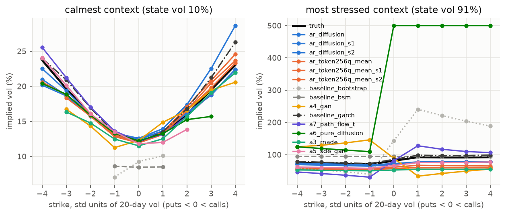

**terminal_distributions**

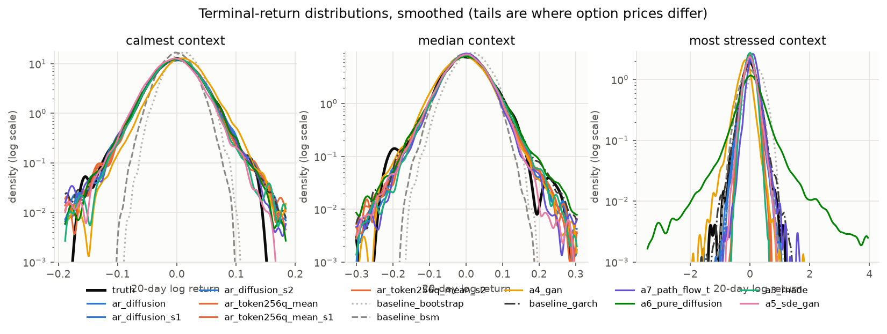

**trackA_leaderboard**

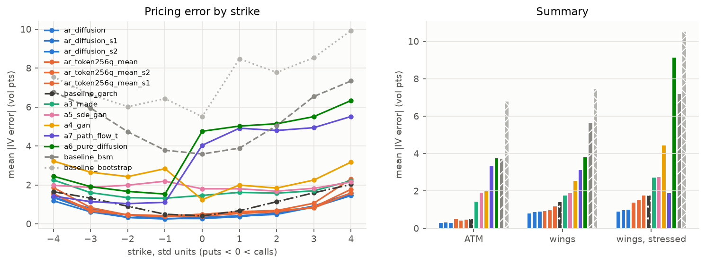

## Training curves

**loss_all**

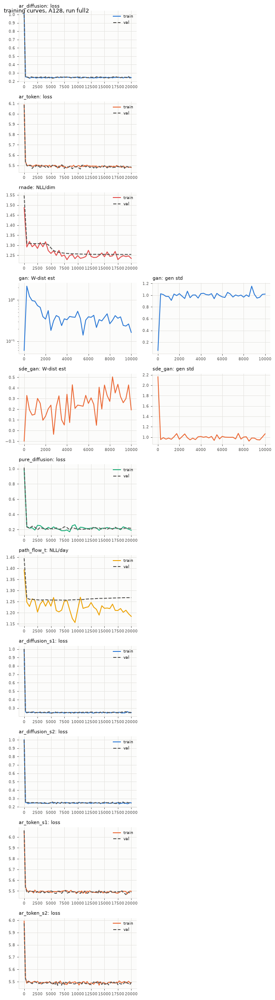

**loss_ar_diffusion**

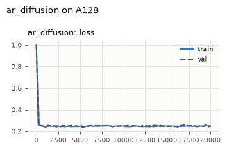

**loss_ar_diffusion_s1**

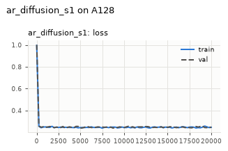

**loss_ar_diffusion_s2**

**loss_ar_token**

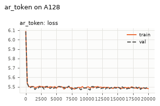

**loss_ar_token_s1**

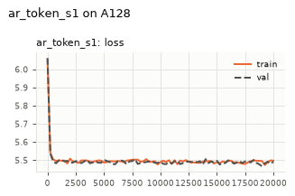

**loss_ar_token_s2**

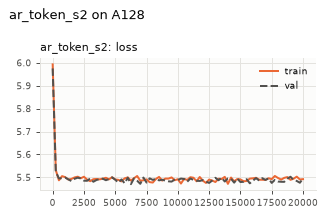

**loss_gan**

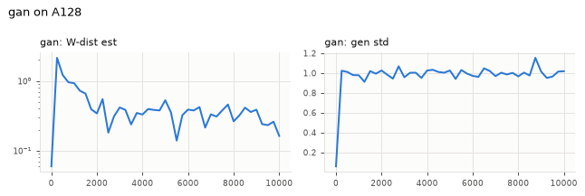

**loss_path_flow_t**

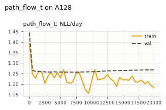

**loss_pure_diffusion**

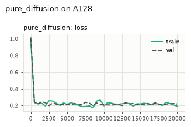

**loss_rnade**

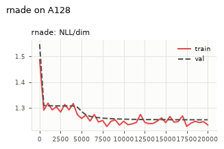

**loss_sde_gan**

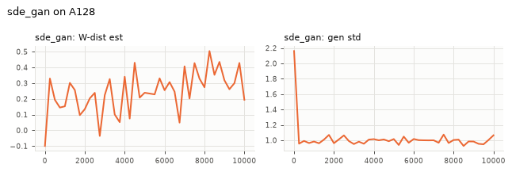

## Simulated paths

**paths_a3_rnade**

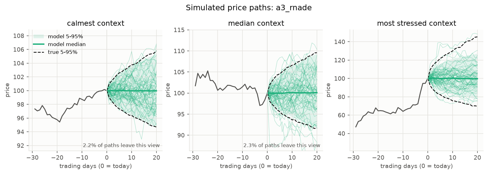

**paths_a4_gan**

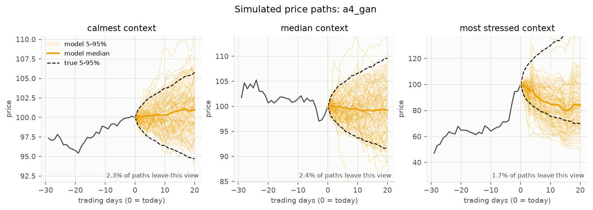

**paths_a5_sde_gan**

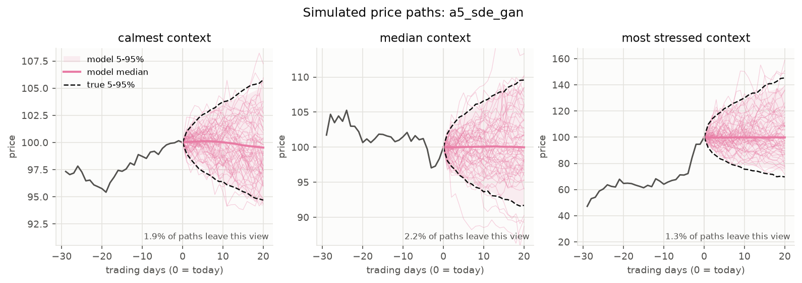

**paths_a6_pure_diffusion**

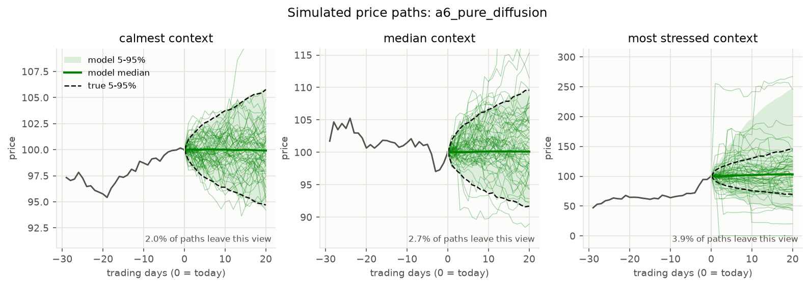

**paths_a7_path_flow_t**

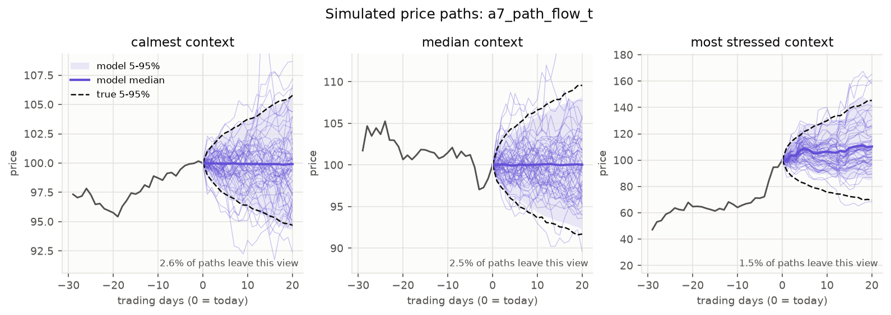

**paths_ar_diffusion**

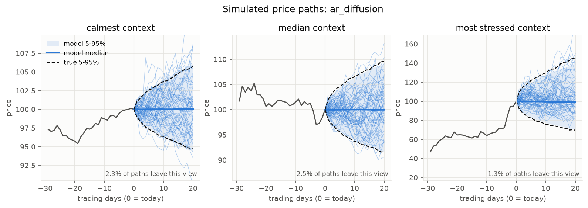

**paths_ar_diffusion_s1**

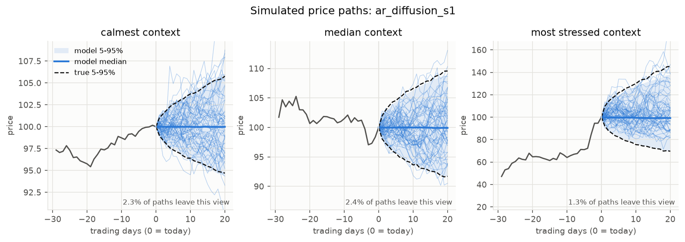

**paths_ar_diffusion_s2**

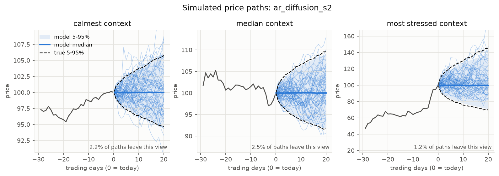

**paths_ar_token256q_mean**

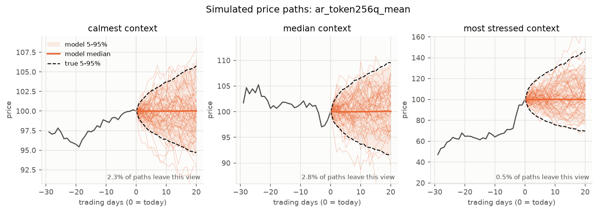

**paths_ar_token256q_mean_s1**

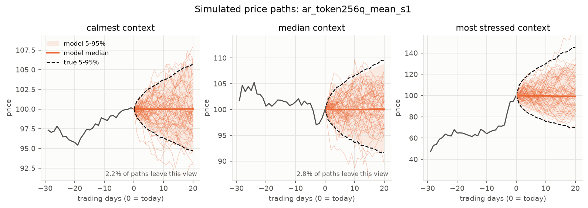

**paths_ar_token256q_mean_s2**

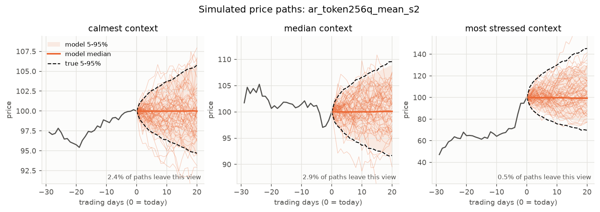

**paths_baseline_bootstrap**

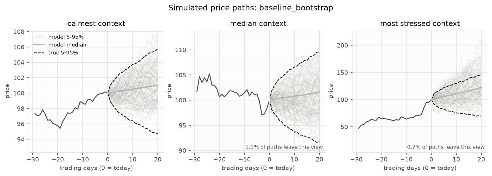

**paths_baseline_bsm**

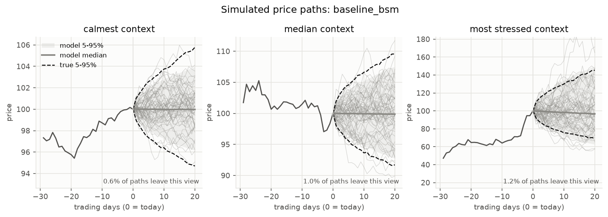

**paths_baseline_garch**

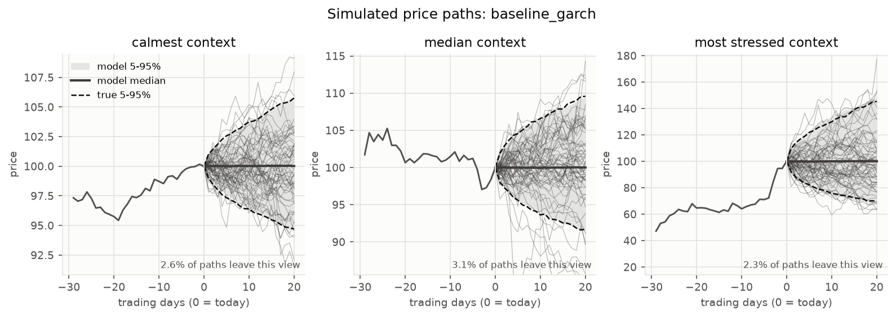

