# megacap_tech, run `full2`

Started 2026-11-26T17:24:03, data `bench_data/real/megacap_tech` (real). Collected 2026-11-26T20:38:06. Only files written after the start are included.

> **Warning:** fatnarwhal_quant not importable: hedging columns will be empty (pip install -e <fatnarwhal-quant>)

## Models

| model | status | min | label | params | train s | gen s | log | last error |
|---|---|---|---|---|---|---|---|---|
| bsm | ok | 0.7 | baseline_bsm | 0 | 0 | 2.8 | [log](logs/bsm.log) |  |
| bootstrap | ok | 0.2 | baseline_bootstrap | 0 | 0 | 2.3 | [log](logs/bootstrap.log) |  |
| garch | ok | 0.5 | baseline_garch | 4 | 0 | 10.6 | [log](logs/garch.log) |  |
| ar_diffusion | ok | 39.4 | ar_diffusion | 2,088,321 | 69 | 1,190.4 | [log](logs/ar_diffusion.log) |  |
| ar_token | ok | 22.4 | ar_token256q_mean | 837,504 | 33 | 645.3 | [log](logs/ar_token.log) |  |
| rnade | ok | 27.6 | a3_rnade | 87,340 | 1,500 | 4.3 | [log](logs/rnade.log) |  |
| gan | ok | 7.4 | a4_gan | 293,908 | 271 | 2.7 | [log](logs/gan.log) |  |
| sde_gan | ok | 8.7 | a5_sde_gan | 194,657 | 465 | 17.6 | [log](logs/sde_gan.log) |  |
| pure_diffusion | ok | 4.1 | a6_pure_diffusion | 3,916,052 | 17 | 131.6 | [log](logs/pure_diffusion.log) |  |
| path_flow_t | ok | 0.7 | a7_path_flow_t | 938,944 | 14 | 3.6 | [log](logs/path_flow_t.log) |  |

## Leaderboard

| model | crps_mean | coverage90 | exceed_1pct | exceed_5pct | qlike | worst |payoff bias t| |
|---|---|---|---|---|---|---|
| a3_rnade | 0.04608 | 0.8937 | 0.009202 | 0.04703 | -3.932 | 4.1 |
| ar_token256q_mean | 0.04612 | 0.91 | 0.005112 | 0.04499 | -3.958 | 2.5 |
| ar_diffusion | 0.04641 | 0.9059 | 0.005112 | 0.04294 | -3.921 | 7.5 |
| a6_pure_diffusion | 0.04647 | 0.9192 | 0.00409 | 0.03374 | -3.905 | 7.5 |
| baseline_garch | 0.04808 | 0.909 | 0.001022 | 0.03476 | -3.886 | 12.7 |
| baseline_bsm | 0.04897 | 0.8906 | 0.00818 | 0.03476 | -3.902 | 9.9 |
| a5_sde_gan | 0.05345 | 0.6084 | 0.1431 | 0.2239 | -2.286 | 7.0 |
| baseline_bootstrap | 0.05419 | 0.8456 | 0.03885 | 0.091 | -3.899 | 5.9 |
| a4_gan | 0.05698 | 0.5859 | 0.136 | 0.2055 | -1.933 | 5.3 |
| a7_path_flow_t | nan | 0.8865 | 0.006135 | 0.05419 | nan | 4.5 |

## Comparison

**backtest_pit**

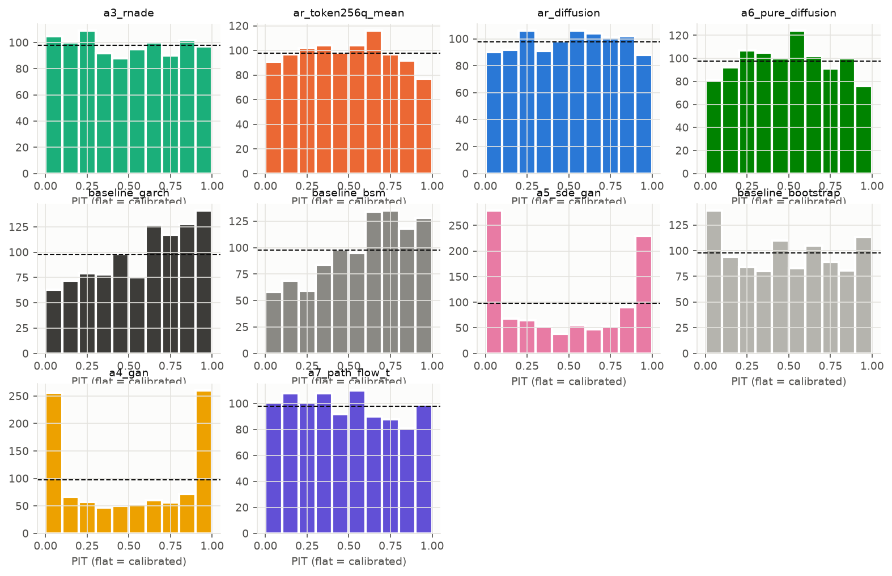

**backtest_summary**

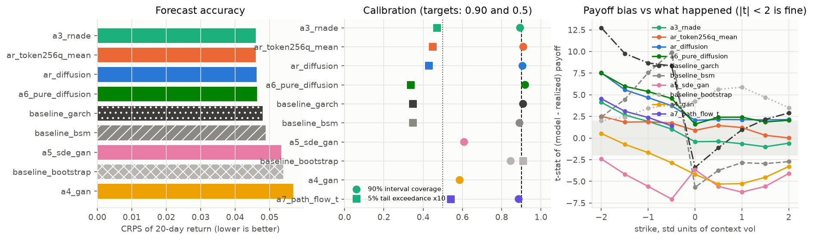

**market_by_moneyness**

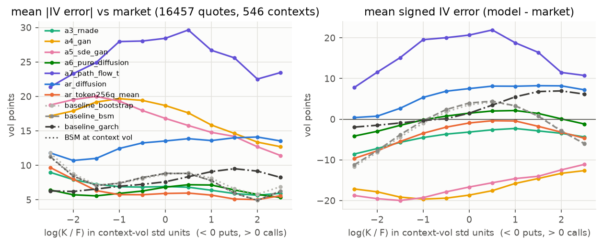

**market_smiles**

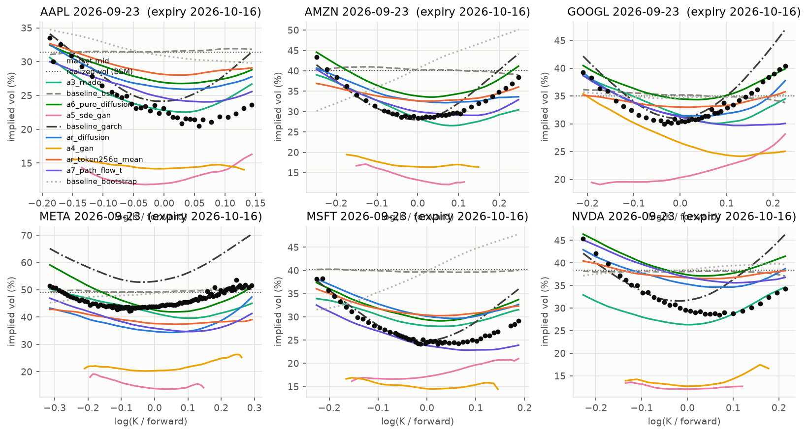

**terminal_distributions**

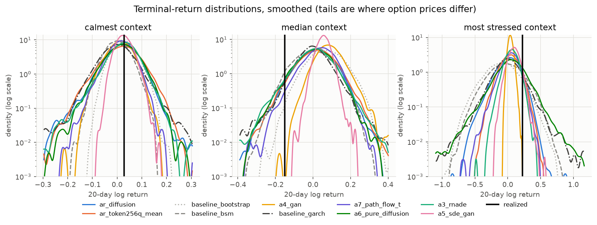

## Training curves

**loss_all**

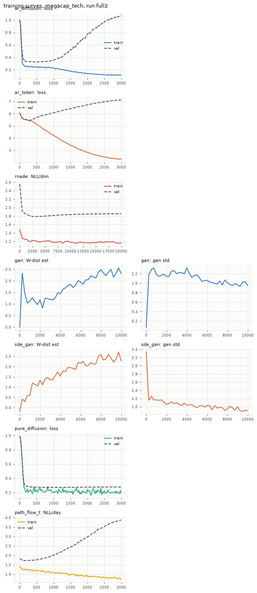

**loss_ar_diffusion**

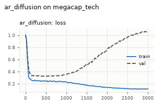

**loss_ar_token**

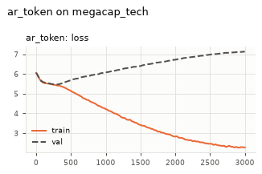

**loss_gan**

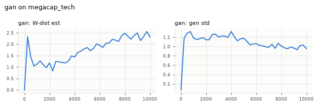

**loss_path_flow_t**

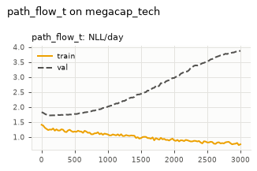

**loss_pure_diffusion**

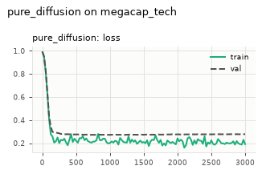

**loss_rnade**

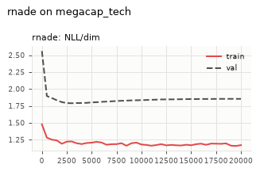

**loss_sde_gan**

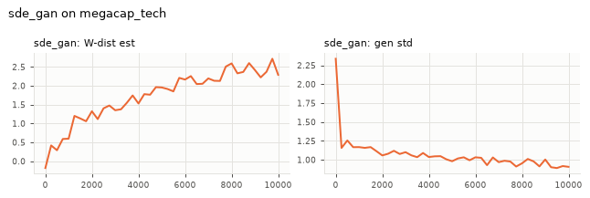

## Simulated paths

**paths_a3_rnade**

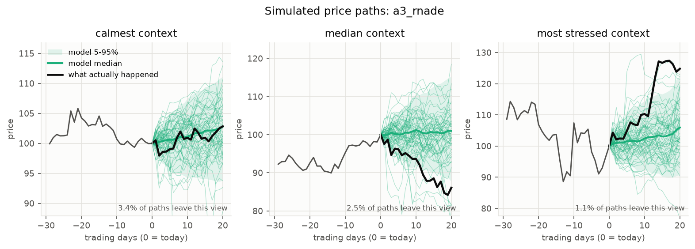

**paths_a4_gan**

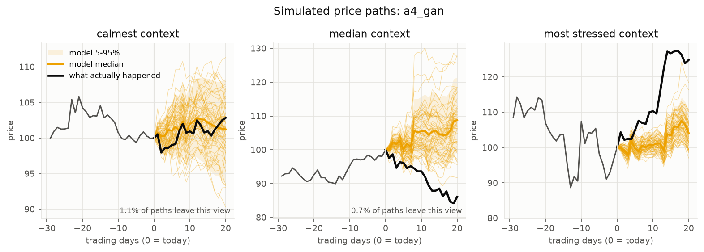

**paths_a5_sde_gan**

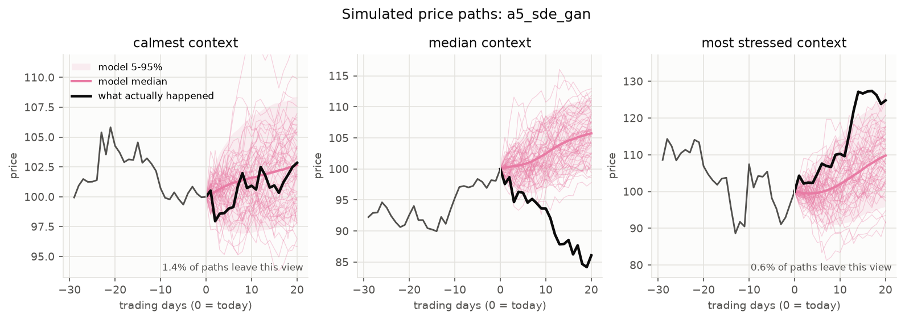

**paths_a6_pure_diffusion**

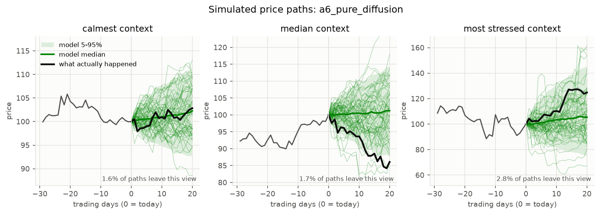

**paths_a7_path_flow_t**

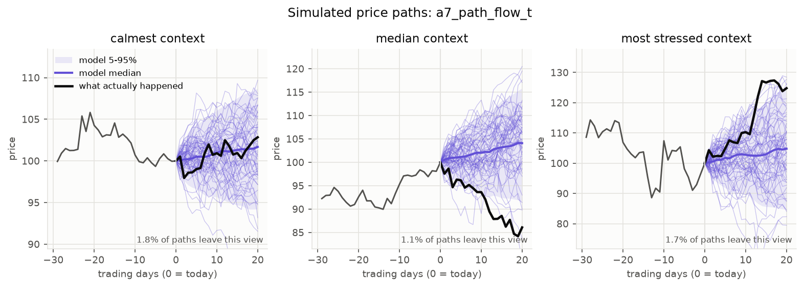

**paths_ar_diffusion**

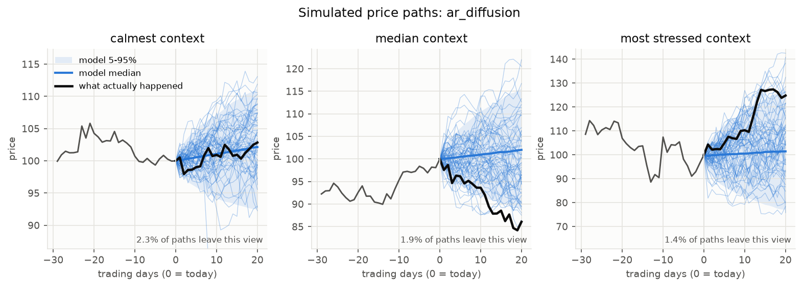

**paths_ar_token256q_mean**

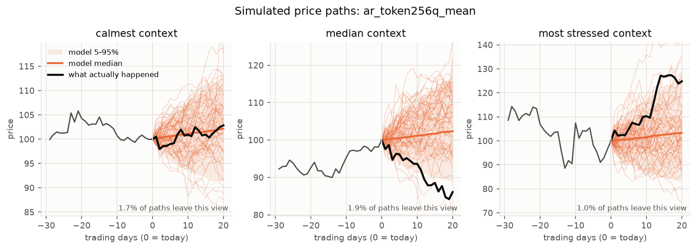

**paths_baseline_bootstrap**

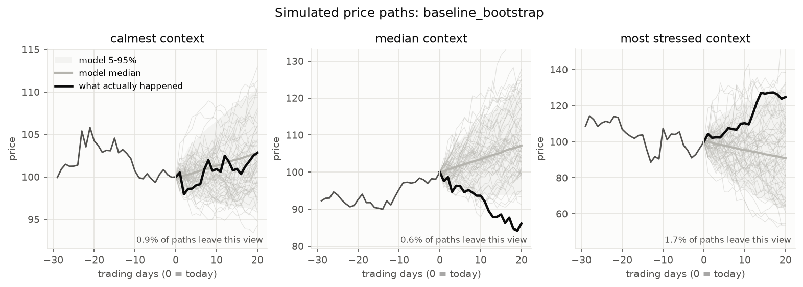

**paths_baseline_bsm**

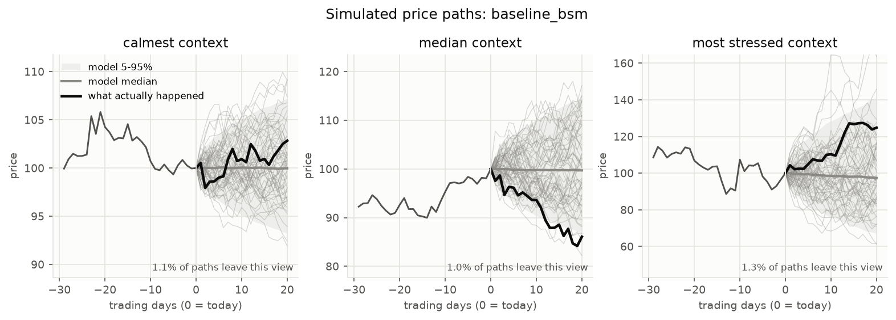

**paths_baseline_garch**

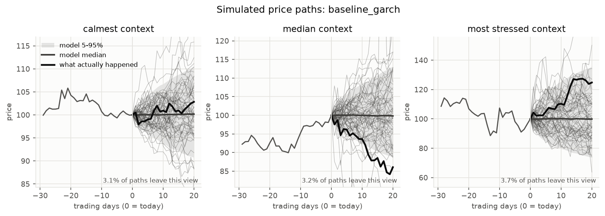

